<div align="center">

# State-Space Studio

**A visual benchmark for feedback control.**

Compare tracking, disturbance rejection and actuator demand across electrical, mechanical and liquid-level models. One reproducible Python toolkit, with a MATLAB/Simulink companion.

[Results](docs/results.md) · [Architecture](docs/architecture.md) · [Theory](docs/theory.md) · [CI configuration](.github/workflows/ci.yml)


[](https://github.com/astral-sh/ruff)


<a href="docs/assets/hero_three_tank.gif">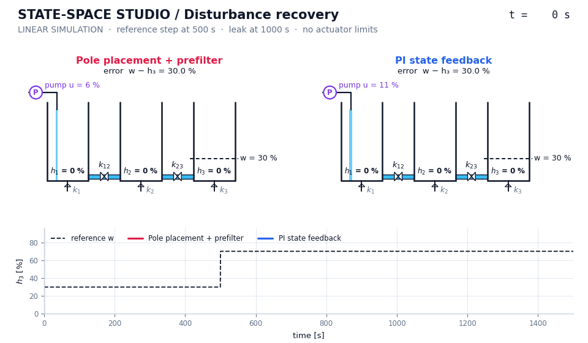</a>

<sub>Same model, same leak. Pole placement (left) drops tank 3 from 70 % to 23 %; PI state feedback (right) recovers to 70 %. Simulated data, rendered by <code>state-space-studio figures</code>.</sub>

</div>

---

## Controller Benchmark

The central question: **which controller recovers from a leak without demanding an infeasible pump command?** All four designs use the same model, initial state and input profile.

<a href="docs/assets/benchmark.png">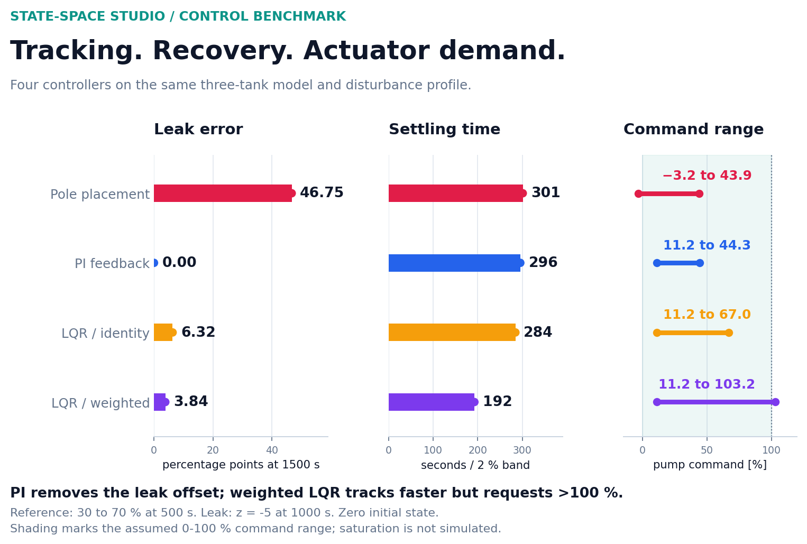</a>

| Design | Leak Error [pp] | Settling [s] | Requested Pump Range [%] |
| --- | ---: | ---: | ---: |
| Pole placement + prefilter | 46.75 | 301 | -3.2 to 43.9 |
| **PI state feedback** | **< 0.01** | 296 | **11.2 to 44.3** |
| LQR / identity weights | 6.32 | 284 | 11.2 to 67.0 |
| LQR / weighted states | 3.84 | **192** | 11.2 to 103.2 |

Error is measured at 1500 s in **percentage points (pp)**. The reference changes from 30 to 70 % at 500 s; the leak begins at 1000 s. Settling time is measured before the leak. The assumed command range is 0-100 %; saturation is not simulated.

**Takeaway:** PI rejects this constant leak while keeping its requested command in range. Weighted LQR tracks faster but requests more than 100 %. [Full results and limitations](docs/results.md).

## More Than One Plant

The same modelling and simulation code also drives a torsional servo and a state-trajectory study.

### Drivetrain Servo

<a href="docs/assets/drivetrain_servo.gif">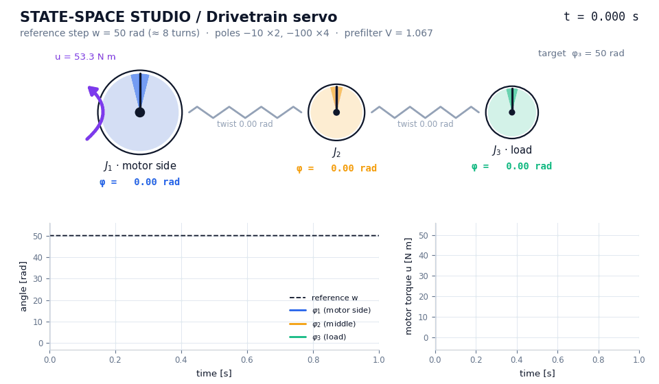</a>

Six states, two flexible shafts, one motor. The simulated load angle settles in **0.62 s** with no overshoot. The load tests expose a separate issue: a static prefilter does not remove the disturbance offset. [Drivetrain results](docs/results.md#drivetrain).

### State Trajectories

<p align="center"><a href="docs/assets/phase_space.gif">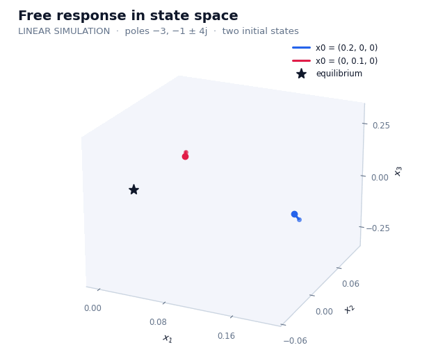</a></p>

Two initial conditions reveal the real and oscillatory modes of the same three-state model. These paths are simulated trajectories, not decorative motion.

## One Connected Toolkit

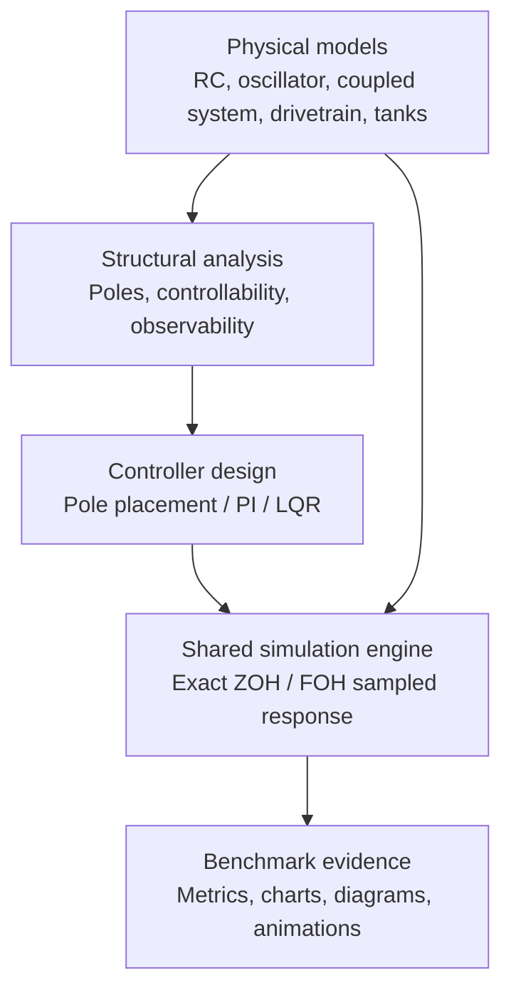

The PI loop used in the main comparison:

<a href="docs/assets/block_pi_state_feedback.svg">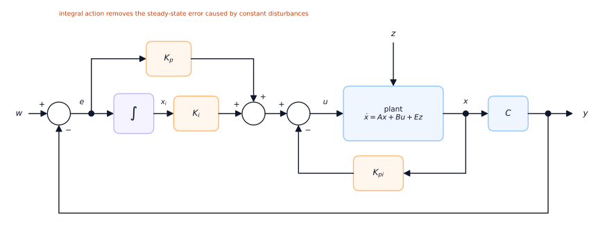</a>

[Code architecture](docs/architecture.md) · [Model and controller derivations](docs/theory.md) · [MATLAB companion](matlab/README.md)

<details>
<summary><b>Explore the model catalogue, response gallery and remaining control diagrams</b></summary>

## Highlights

| Area | What's inside |
| --- | --- |
| **Five plants** | RC ladder · coupled two-input system · mass–spring–damper · three-mass torsional drivetrain · three-tank liquid-level process |
| **Three controller families** | pole placement with Ackermann's formula + prefilter · PI state feedback (integral action) · LQR from the algebraic Riccati equation |
| **Exact simulation** | matrix-exponential discretisation (zero- and first-order hold), checked against SciPy to 1e-9 |
| **Measured, not guessed** | rise and settling time, overshoot, steady-state error, IAE and actuator range for every design |
| **Two toolchains** | Tested Python package and CI configuration · MATLAB companion · Simulink diagrams built by a script |

### What the numbers say

1. **PI rejects the leak in this benchmark.** At 1500 s its error rounds to **0.00 percentage points**, versus **46.75** with pole placement and **6.32 / 3.84** with the two LQR designs.
2. **Faster tracking costs actuator headroom.** The tuned LQR settles in **192 s** (PI: 296 s) but requests **103 % pump command**, outside the assumed 0–100 % range; pole placement requests **−3.2 %**. These are unconstrained simulations, not saturation tests.
3. **Rules of thumb are optimistic for critical damping.** $t_s \approx 4/(\zeta\omega_n)$ promises 200 s; a critically damped double pole needs $5.83/\omega_n$, and the simulation measures **296–301 s**.
4. **The drivetrain is only marginally stable** (a rigid-body pole at $\lambda = 0$). Pole placement turns it into a servo — a 50 rad step in **0.62 s with no overshoot** — yet a 1 N m load on the far inertia still moves it by **−36.6 rad**: the load twists each shaft by 0.67 rad, the large opposite-signed angle gains (75.8, −211.7, 136.9) turn that twist into a torque bias, and only the weak rigid-body "virtual spring" $\sum K_\varphi = V = 1.067$ N m/rad resists it.

## Contents

- [The workflow](#the-workflow)
- [The plants](#the-plants)
- [Results](#results)
- [Control architectures](#control-architectures)
- [How the code fits together](#how-the-code-fits-together)
- [Quick start](#quick-start)
- [Repository layout](#repository-layout)
- [Testing](#testing)
- [Theory in one screen](#theory-in-one-screen)
- [Background](#background)

## The workflow

Every case study runs the same pipeline. Each box is a module, and every figure and number in this README is produced by it.

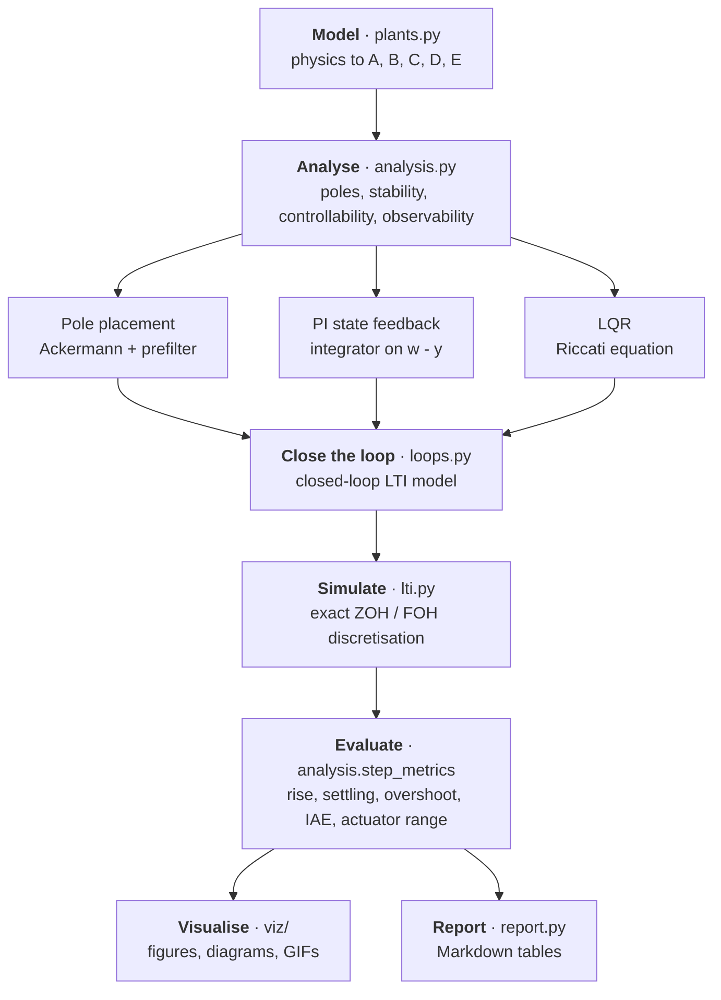

## The plants

| Plant | States | Physics | What it demonstrates |
| --- | :-: | --- | --- |
| RC ladder | 3 | three cascaded RC stages, $v_3$ measured | real poles, cascaded lags, step vs. free response |
| Coupled two-input system | 3 | real mode at −3 driving a pair at $-1 \pm 4j$ | MIMO inputs, ramp input (first-order hold), 3-D state trajectories |
| Mass–spring–damper | 2 | $m\ddot{x} + b\dot{x} + cx = u$ | overdamped eigen-directions in the phase portrait |
| Three-mass drivetrain | 6 | inertias $J_{1..3}$, shafts $k_{12}, k_{23}$, dampers $d_{1..3}$ | rigid-body mode, torsional modes at 7.4 Hz and 16.6 Hz, pole placement with repeated poles, load torques |
| Three-tank process | 3 | pump into tank 1, valves, drains, leak $z$ | pole placement vs. PI vs. LQR on one test, actuator limits |

<p align="center">
  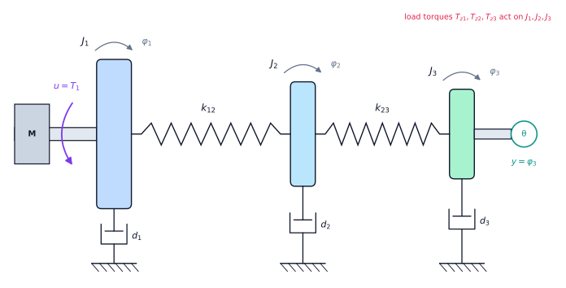<br>
  <sub>Drivetrain: motor torque <i>u</i> on <i>J</i><sub>1</sub>, measured load angle <i>y</i> = <i>φ</i><sub>3</sub>, load torques <i>T</i><sub>z1</sub>, <i>T</i><sub>z2</sub>, <i>T</i><sub>z3</sub></sub>
</p>

<p align="center">
  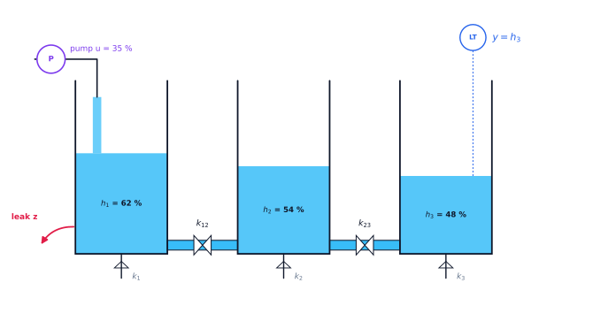<br>
  <sub>Three tanks: pump <i>u</i> into tank 1, valves <i>k</i><sub>12</sub> and <i>k</i><sub>23</sub>, drains <i>k</i><sub>1..3</sub>, measured level <i>y</i> = <i>h</i><sub>3</sub>, leak <i>z</i></sub>
</p>

## Results

### Structural properties

| Plant | n | Open-loop poles | Stability | rank $Q_c$ | rank $Q_o$ |
| --- | :-: | --- | --- | :-: | :-: |
| RC ladder | 3 | −0.812, −0.389, −0.0495 | asymptotically stable | 3 | 3 |
| Coupled two-input system | 3 | −3, −1 ± 4j | asymptotically stable | 3 | 3 |
| Mass–spring–damper | 2 | −14.5, −5.53 | asymptotically stable | 2 | 2 |
| Three-mass drivetrain | 6 | −10.3 ± 104j, −9.2 ± 46.6j, −8.76, 0 | marginally stable | 6 | 6 |
| Three-tank process | 3 | −0.241, −0.0829, −0.00397 | asymptotically stable | 3 | 3 |

All five are controllable and observable, so every pole can be placed and every state could be reconstructed by an observer.

### Response Foundations

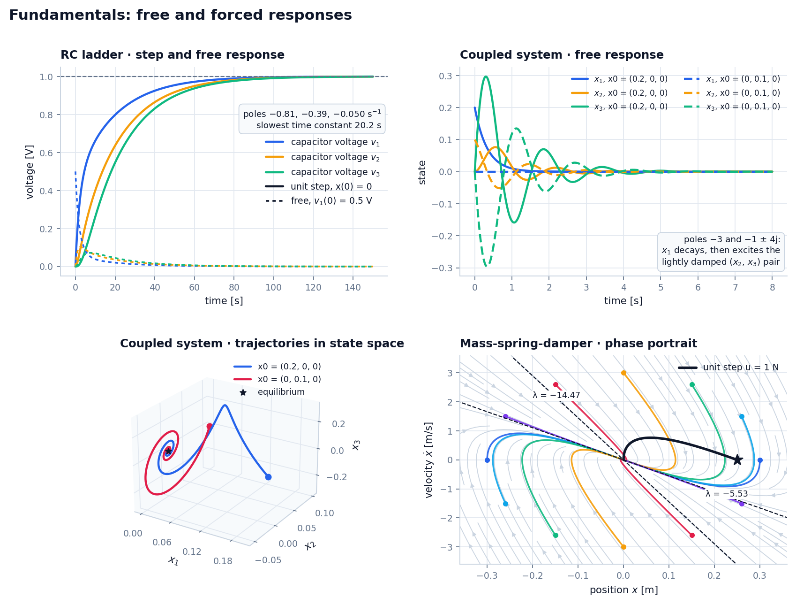

<table>
  <tr>
    <td width="52%"><a href="docs/assets/phase_space.gif">Open the full-size state-trajectory animation</a></td>
    <td>
      <b>Reading the plots</b>
      <ul>
        <li>The RC ladder charges like a cascade: each capacitor lags the previous one, the slowest time constant is 20.2 s.</li>
        <li>In the coupled system the decoupled state <i>x</i><sub>1</sub> decays at −3 and excites the lightly damped (<i>x</i><sub>2</sub>, <i>x</i><sub>3</sub>) pair, hence the spirals.</li>
        <li>The overdamped mass–spring–damper pulls every trajectory onto its slow eigen-direction (λ = −5.53) before it reaches equilibrium.</li>
      </ul>
    </td>
  </tr>
</table>

<details>
<summary>Coupled system under a step and a ramp input</summary>

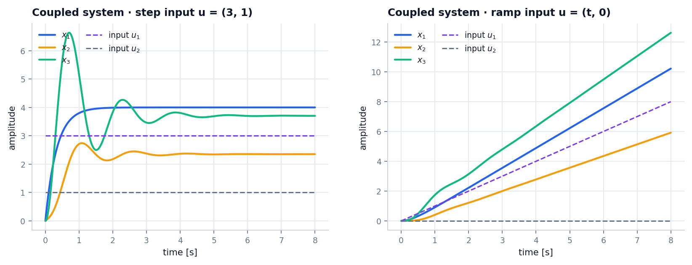

The ramp is simulated with a first-order hold, which is exact for piecewise-linear inputs.
</details>

### Drivetrain Load Cases

[Open the drivetrain animation](docs/assets/drivetrain_servo.gif)

Pole placement at $-10, -10, -100, -100, -100, -100$ with Ackermann's formula gives

$$K = [75.84,\ -211.7,\ 136.9,\ 0.7445,\ -0.860,\ 0.2695], \qquad V = 1.0667$$

| Test case | φ1 (1 s) [rad] | φ2 (1 s) [rad] | φ3 (1 s) [rad] | u (1 s) [N m] | max \|u\| [N m] |
| --- | --: | --: | --: | --: | --: |
| Reference step $w$ = 50 rad | 49.966 | 49.965 | 49.963 | 0.000 | 53.33 |
| Load torque $T_{z1}$ = 1 N m | 0.937 | 0.937 | 0.937 | −1.000 | 1.06 |
| Load torque $T_{z2}$ = 1 N m | 47.642 | 48.307 | 48.306 | −1.000 | 8.96 |
| Load torque $T_{z3}$ = 1 N m | −37.884 | −37.216 | −36.548 | −1.000 | 6.50 |
| $T_{z2}$ = 0.5 N m and $T_{z3}$ = 1 N m | −14.063 | −13.062 | −12.395 | −1.500 | 3.99 |

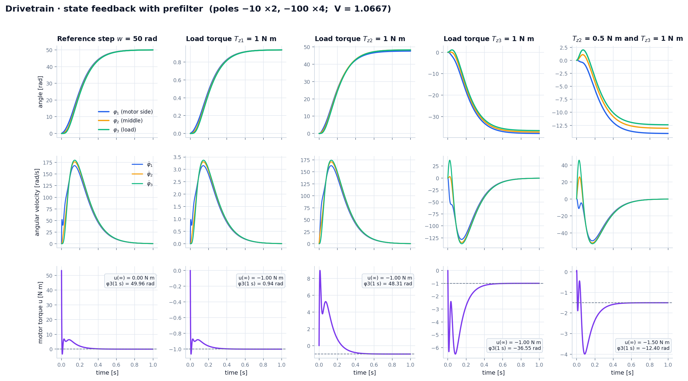

- **Tracking:** rise time 0.34 s, 2 % settling time 0.62 s, no overshoot. The dominant double pole at −10 promises 0.4 s by the $4/\sigma$ rule; a critically damped pair really needs $5.83/10$ s.
- **Disturbances:** the motor always ends up cancelling the total load torque ($u_\infty = -\sum T_z$), but the position offset depends on *where* the load acts — 0.94 rad when it sits on the motor inertia, up to 48 rad when it acts across a shaft. This is the price of proportional state feedback without integral action.

<details>
<summary>Open-loop behaviour: two torsional modes and a rigid-body mode</summary>

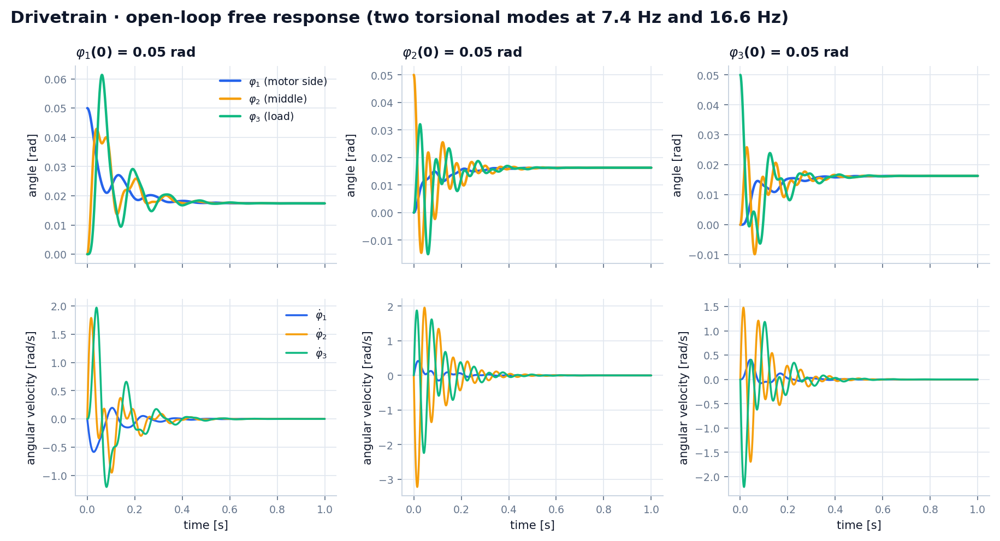
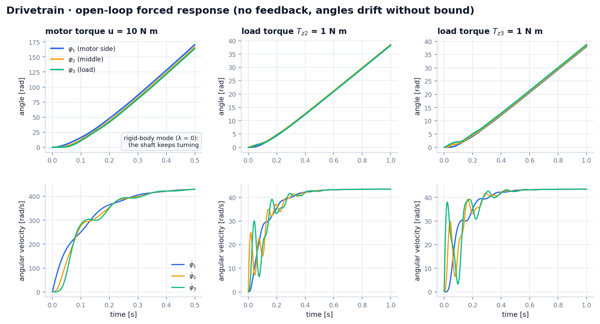

With no feedback a constant 10 N m torque spins the shaft up to $\omega_\infty = 10 / \sum d_i = 435$ rad/s and the angles grow without bound.
</details>

### Three-Tank Controller Comparison

Every controller sees the same profile: reference 30 → 70 % at $t$ = 500 s, then a leak $z = -5$ from $t$ = 1000 s.

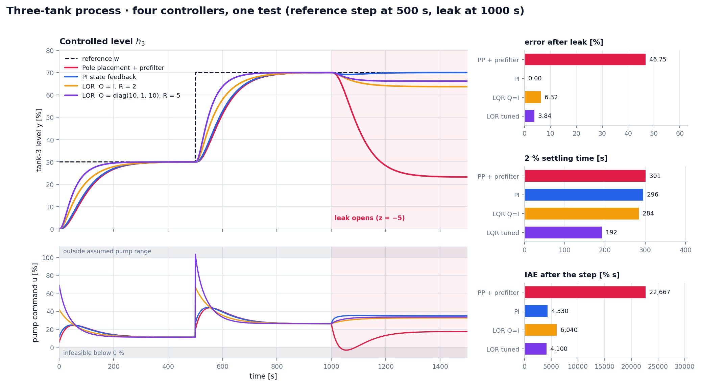

| Controller | Closed-loop poles | Rise [s] | Settling 2 % [s] | Error before leak [%] | Error after leak [%] | Pump range [%] | IAE [% s] |
| --- | --- | --: | --: | --: | --: | --: | --: |
| Pole placement + prefilter | −0.1, −0.02 (×2) | 170 | 301 | 0.02 | **46.75** | **−3.2** … 43.9 | 22 667 |
| PI state feedback | −0.2 (×2), −0.02 (×2) | 168 | 296 | 0.02 | **0.00** | 11.2 … 44.3 | 4 330 |
| LQR, Q = I, R = 2 | −0.241, −0.0847, −0.0145 | 155 | 284 | 0.04 | 6.32 | 11.2 … 67.0 | 6 040 |
| LQR, Q = diag(10, 1, 10), R = 5 | −0.242, −0.0901, −0.0223 | 104 | **192** | 0.00 | 3.84 | 11.2 … **103.2** | **4 100** |

Gains: pole placement $K = [-5.529,\ 11.44,\ -5.789]$, $V = 0.1886$ · PI $K_x = [3.294,\ 2.764,\ 0.978]$, $K_i = 0.0755$, $K_p = 0.3739$ · LQR $K = [0.3666,\ 0.2954,\ 0.2611]$ and $[0.7881,\ 0.5041,\ 0.4324]$.

- **Why pole placement fails here:** the target poles (−0.02, −0.02, −0.1) are *slower* than two of the plant's own poles (−0.24, −0.083). The controller has to slow the process down with negative gains, which weakens the loop against the leak.
- **Why PI wins:** the integrator state keeps growing until the error is zero, so any constant leak is compensated exactly — with the same dominant poles and almost the same settling time.
- **LQR in this benchmark:** both computed gains have positive entries and reduce the measured offset, but neither design rejects this leak completely. Gain signs alone are not a general robustness test.

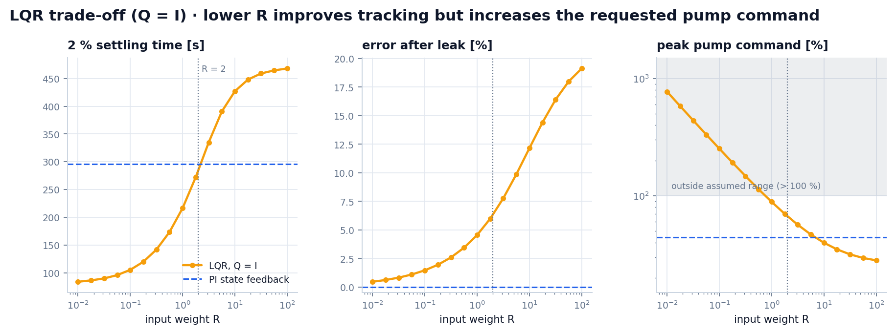

<details>
<summary>Open-loop behaviour of the tanks</summary>

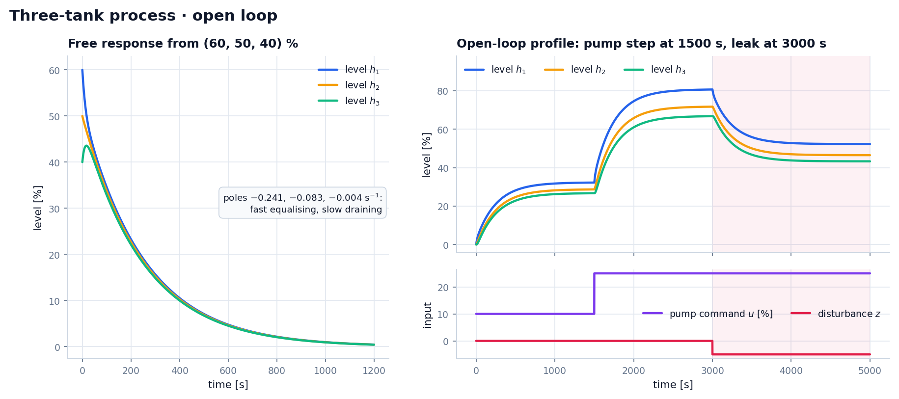
</details>

### Pole Locations

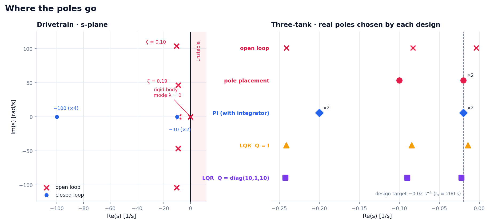

## Control architectures

All loops are built from the same plant structure — integrators and gain blocks, exactly as in the generated Simulink models.

<details open>
<summary><b>Plant</b> &nbsp;·&nbsp; <code>x' = A x + B u + E z,  y = C x + D u</code></summary>

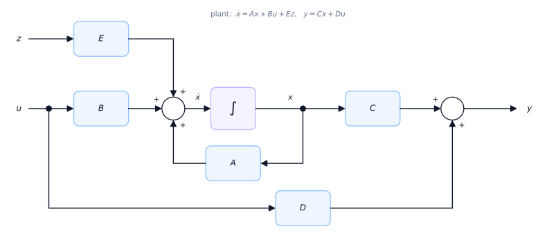
</details>

<details open>
<summary><b>State feedback with prefilter</b> &nbsp;·&nbsp; <code>u = V w - K x</code> (pole placement and LQR)</summary>

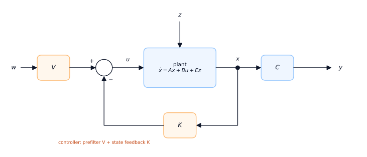
</details>

<details open>
<summary><b>PI state feedback</b> &nbsp;·&nbsp; <code>u = Kp e + Ki xi - Kpi x,  xi' = e = w - y</code></summary>


</details>

## How the code fits together

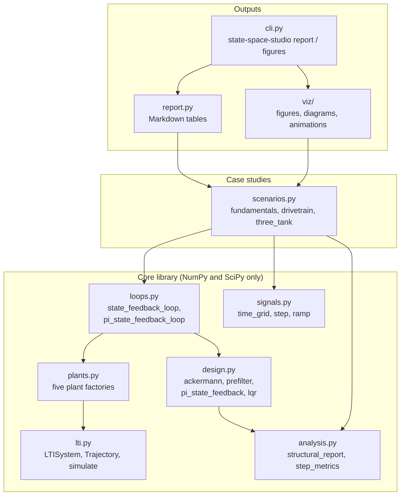

The MATLAB companion mirrors the plant models and principal controller designs (`models/`, `toolbox/`, `studies/`) — see [matlab/README.md](matlab/README.md). It has not been executed in MATLAB here. More diagrams are in [docs/architecture.md](docs/architecture.md).

</details>

## Quick start

### Python

```bash
python -m pip install -e ".[dev]"

state-space-studio report        # structural analysis and controller tables as Markdown
state-space-studio figures       # re-render every figure, diagram and GIF into docs/assets
python -m pytest         # numerical, model, CLI and rendering checks
```

```python
from state_space_studio import design, loops, plants, signals, step_metrics

plant = plants.three_tank()
gains = design.pi_state_feedback(plant.A, plant.B, plant.C, poles=[-0.02, -0.02, -0.2, -0.2])
loop = loops.pi_state_feedback_loop(plant, gains)

t = signals.time_grid(1500, 0.5)
run = loop.simulate(t, {"w": signals.step(t, 500, 30, 70), "z": signals.step(t, 1000, 0, -5)})

print(round(run.final("y"), 2))  # 70.0 -> the leak is fully rejected
print(step_metrics(t, run["y"], target=70, t_step=500, t_end=999.5))
```

### MATLAB / Simulink

```matlab
cd matlab
results = run_all();              % three studies, figures stay open
results = run_all("figures");     % ... and export them as PNG

cd simulink
build_simulink_models();          % generate the Simulink block diagrams
report = run_simulink_crosscheck(); % Simulink vs. lsim, largest deviation per model
```

Requires MATLAB R2020a or newer with the Control System Toolbox; Simulink only for the `simulink/` folder.

## Repository layout

<details>
<summary>Source and documentation map</summary>

```text
state-space-studio/
├── src/state_space_studio/          Python package
│   ├── lti.py               LTI system, trajectory, exact ZOH/FOH simulation
│   ├── plants.py            the five plant models with physical parameters
│   ├── analysis.py          stability, controllability, observability, step metrics
│   ├── design.py            Ackermann, prefilter, PI state feedback, LQR
│   ├── loops.py             closed-loop interconnections
│   ├── signals.py           time grids, steps, ramps
│   ├── scenarios.py         the case studies (single source of every number)
│   ├── report.py            Markdown summary
│   ├── cli.py               `state-space-studio report | figures`
│   └── viz/                 figures, block diagrams, schematics, GIFs
├── tests/                   numerical, CLI and rendering tests
├── matlab/
│   ├── models/              plant models (struct with A, B, C, D, E)
│   ├── toolbox/             analysis, design, loops, plotting helpers
│   ├── studies/             study_01_fundamentals, study_02_drivetrain, study_03_three_tank
│   ├── simulink/            build_simulink_models, run_simulink_crosscheck
│   └── run_all.m
├── docs/
│   ├── theory.md            derivations behind every design
│   ├── results.md           all results with discussion
│   ├── architecture.md      code structure and data flow
│   └── assets/              rendered figures, diagrams and animations
└── .github/workflows/ci.yml lint, tests on Python 3.11–3.14, figure build
```

</details>

## Testing

The test suite pins the physics and the numbers rather than just exercising the code:

- **Simulation:** zero- and first-order-hold results match `scipy.signal.lsim` to 1e-9 and analytic first-order step and ramp responses to 1e-12.
- **Models:** the drivetrain matrices equal the hand-written equations of motion, $[1, 1, 1, 0, 0, 0]^\top$ spans the rigid-body null space, the tank matrix only loses liquid through the drains (column sums $= -k_i$).
- **Design:** Ackermann places random and repeated poles, the prefilter gives unit DC gain, the drivetrain prefilter equals the original value 1.0667, the LQR gain satisfies the Riccati equation and the scalar closed form.
- **Loops and studies:** closed-loop steady states match $-A_{cl}^{-1}B_{cl}u$, PI rejects a constant leak, the controller ranking and the settling-time finding are asserted.
- **Outputs:** the CLI renders every figure and diagram, SVGs carry no timestamps, the GIF encoder keeps white pure white.

The CI configuration targets Python 3.11–3.14, publishes the Markdown report to the job summary and renders the figures. Hosted CI results are available only after the workflow runs on GitHub.

## Model limits

These are continuous-time, linear, full-state-feedback simulations, not hardware measurements. The pump range is a feasibility reference only: saturation, anti-windup, sensor noise, an observer, delays and nonlinear fluid dynamics are not simulated. Timing metrics use sampled responses and their final values; they are not hardware guarantees. MATLAB/Simulink execution remains unverified on this machine.

## Theory in one screen

<details>
<summary>Core equations</summary>

| Step | Result |
| --- | --- |
| Model | $\dot{x} = Ax + Bu + Ez,\quad y = Cx + Du$ |
| Exact sampling (ZOH) | $x_{k+1} = e^{Ah}x_k + \int_0^h e^{A\tau}\mathrm{d}\tau\ B u_k$ via one matrix exponential |
| Controllability | $\operatorname{rank}\ [B,\ AB,\ \dots,\ A^{n-1}B] = n$ |
| Ackermann | $K = e_n^\top Q_c^{-1}\ \varphi_d(A)$ with the desired characteristic polynomial $\varphi_d$ |
| Prefilter | $V = \left[C (BK - A)^{-1} B\right]^{-1}$ for zero steady-state error to steps in $w$ |
| PI state feedback | augment the plant with $\dot{x}_i = w - y$, place all $n + 1$ poles, split the gain into $K_p$, $K_i$, $K_{pi}$ |
| LQR | $A^\top P + PA - PBR^{-1}B^\top P + Q = 0,\quad K = R^{-1}B^\top P$ |

Derivations, including the virtual-spring argument for the drivetrain and the settling time of a critically damped pole pair, are in [docs/theory.md](docs/theory.md).

</details>

## Background

The case studies started life as state-space control lab exercises. Everything here was re-derived, rewritten and extended into one consistent toolkit: a tested Python package, refactored MATLAB code with a shared structure, Simulink models generated from code instead of hand-edited binaries, quantitative comparisons and new visualisations.

## License

[MIT](LICENSE)
