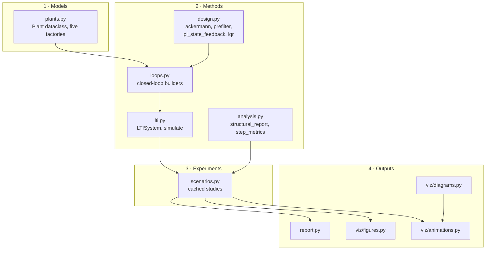
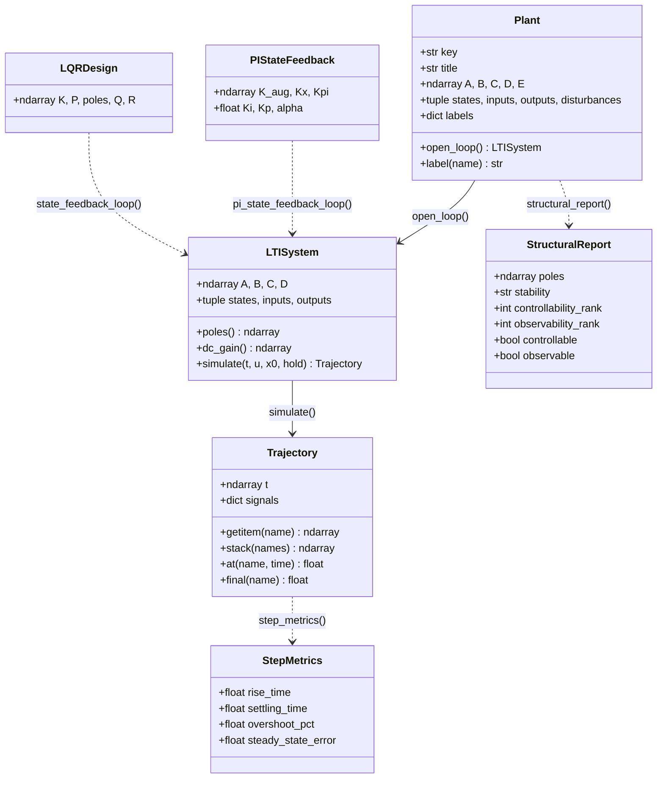
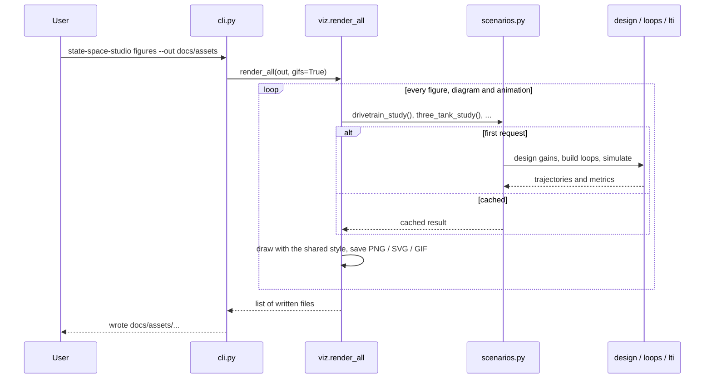

# Architecture

How the Python package is organised, how data flows through it and how to extend it. The MATLAB toolbox follows the same structure (see [matlab/README.md](../matlab/README.md)).

## Layers



- **Models** know physics only: parameters in, matrices and signal labels out.
- **Methods** are pure functions on matrices; none of them knows which plant it is working on.
- **Experiments** combine both into reproducible studies. Each study is computed once per process (`functools.cache`) and shared by the report, the figures, the GIFs and the tests.
- **Outputs** never compute physics themselves; they only read study results.

## Core data types



Signals are addressed **by name** everywhere: a closed loop built by `state_feedback_loop` has inputs `("w", *disturbances)` and outputs `("y", "u")`, so a simulation reads like the block diagram:

```python
run = loop.simulate(t, {"w": step(t, 500, 30, 70), "z": step(t, 1000, 0, -5)})
run["h3"], run["u"], run.final("y")
```

## What happens on `state-space-studio figures`



## Design decisions

| Decision | Reason |
| --- | --- |
| Exact discretisation instead of an ODE solver | Linear systems with piecewise-constant or piecewise-linear inputs have closed-form samples; results are deterministic and step-size independent. |
| Ackermann's formula instead of `scipy.signal.place_poles` | The lab designs use repeated poles (−10 ×2, −100 ×4), which `place_poles` rejects for single-input systems. |
| Closed loops as plain `LTISystem`s | The same simulator, pole computation and DC gain work for open and closed loops; the interconnection is a few lines of block-matrix algebra that mirror the block diagrams. |
| `matplotlib.figure.Figure` instead of `pyplot` | No global state, no GUI backend, safe in CI and tests. |
| One shared GIF palette, no dithering | Flat-colour frames compress to 0.5–1 MB instead of several MB and keep white backgrounds pure white. |
| Simulink models generated by a script | Diagrams are reviewable as text, reproducible and free of binary metadata. |

## Extending the toolkit

**A new plant** — add a factory to `plants.py` that returns a `Plant`, register it in `PLANTS`, and the structural-property test in `tests/test_plants.py` covers it automatically:

```python
def inverted_pendulum(params: PendulumParams | None = None) -> Plant:
    p = params or PendulumParams()
    return Plant(
        key="pendulum",
        title="Inverted pendulum",
        A=...,
        B=...,
        C=...,
        D=[[0.0]],
        E=np.zeros((4, 0)),
        states=("x", "theta", "v", "omega"),
        inputs=("u",),
        outputs=("y",),
    )
```

**A new controller** — write the design in `design.py` (pure matrices in, gains out) and, if it needs new states such as an observer, an interconnection in `loops.py` that returns an `LTISystem`. Everything downstream (simulation, metrics, plots) then works unchanged.
